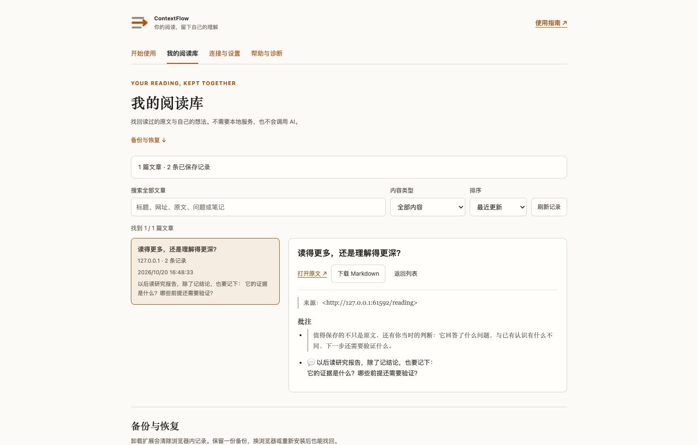

<h1>ContextFlow</h1>

<h3>Turn what you read into context you can reuse.</h3>

Think beside the source. Go deeper with AI. Keep the knowledge in your own tools.

  <a href="https://chromewebstore.google.com/detail/contextflow/aemncphfnlpbhlddifhohpgegejjejfm"><strong>Install from Chrome Web Store</strong></a>
  · <a href="https://pengheliu.github.io/ContextFlow/">Website</a>
  · <a href="https://pengheliu.github.io/ContextFlow/download.html">Desktop app</a>
  · <a href="#get-started">Get started</a>
  · <a href="./README.md">中文</a>

Open source · Local-first · Markdown · Obsidian · SiYuan

> **Read in the extension. Connect your tools through the desktop app.** Start with one annotation. Add your own models and notes when you need AI or sync—without a terminal-based installation.

ContextFlow is a browser reading workspace for people who read to understand. Keep **passages, questions, and your own judgments** together as you work through papers, technical articles, and research reports—then bring them back to your notes.

Actual interface on original sample text: write beside the source and review the same record in the panel. No private reading data.

## Keep more than the article. Keep why it mattered.

### Think without leaving the source

Select a passage to highlight it, write an inline annotation, or paste a screenshot. Capture a thought where it occurs without moving it to a separate document first.

The inline editor and reading panel share **one record**. Write in place, review in the panel, and jump back to the original passage. ContextFlow attempts to restore saved highlights when you revisit the article.

### Follow the question, in context

Explain or translate a selection and ask follow-up questions on the page. Start with an overview of a long article, then investigate the passages that matter. AI results stay with your reading records, alongside your own additions and pasted images.

Choose your own model or local agent. AI requires the optional companion service; annotations and export work independently.

### Bring the reading back to your notes

Copy or download Markdown that includes the source, reading records, and your own summary. With the companion connected, sync to **Obsidian, a Markdown folder, or SiYuan**.

The same article updates the same note rather than creating a new copy on every sync. Input saves automatically in the browser; writing to your note destination happens when you click **同步** (Sync). Your notes remain portable and editable in your own tools.

## Bring earlier understanding into what you read now

Your notes can be more than an output destination. Give a local agent with a supported reading mode permission to read a chosen notes directory, then ask questions that connect the current article to earlier work:

- **Compare perspectives:** How does this conclusion differ from my previous understanding?
- **Find connections:** Which notes discuss the same problem?
- **Continue an investigation:** Does this evidence answer a question I left open?

ContextFlow connects the web, AI, and your existing knowledge rather than creating another closed collection. Retrieval and answer quality depend on your agent, permissions, and notes. Verify important conclusions against the sources. The sync destination and the agent's reading directory are configured separately; selecting a vault does not grant the agent access. [Product philosophy (Chinese) →](./docs/PRODUCT.md)

## Get started

**Start with useful reading, not AI configuration.** Highlights, inline annotations, pasted images, and Markdown export need no account, API key, Node.js, or running service.

1. **Install.** Choose **Add to Chrome** on the [Chrome Web Store](https://chromewebstore.google.com/detail/contextflow/aemncphfnlpbhlddifhohpgegejjejfm). No ZIP download or Developer mode is needed.
2. **Capture a thought.** Refresh an article, select a sentence, and click **批注** (Annotate). The [practice article](https://pengheliu.github.io/ContextFlow/demo.html) provides a guided first use.
3. **Keep the result.** Open the right-hand reading panel and click **下载** (Download) for Markdown containing your source and annotations.

[Full installation and troubleshooting guide (Chinese) →](./docs/GETTING_STARTED.md)

### Add AI or note sync when you need them

The [desktop download page](https://pengheliu.github.io/ContextFlow/download.html) provides Desktop 1.1.0 for Apple Silicon as a DMG with a SHA-256 checksum; macOS 13.5+ is required. The package includes its runtime, so end users do not need Node.js, Git, or npm. Intel Mac and Windows installers are not open for download; do not substitute a different architecture.

Open the desktop app → choose **连接桌面端** (Connect desktop) in the extension's **连接与设置** → verify the request and choose **允许连接** (Allow) in the desktop dialog → optionally test and save a model or agent → save and confirm a note destination → return to an article for a real answer or click **同步** (Sync). No terminal or manual pairing-code generation/copying is required. Chrome profiles authorize separately and can be revoked individually. AI and note sync are independent; sync does not require a model.

Discovery lists candidates, not verified logins or permissions. Connection tests are explicit, may incur charges, and do not validate note access or writing. Confirming a destination does not sync anything automatically.

One-click connection needs a matching extension with the required permission. Check actual store availability in the [installation guide](./docs/GETTING_STARTED.md#版本与发行记录). Do not uninstall to update: that can erase browser records. The interface is primarily in Chinese.

**Safety and scope:** this Mac package is not Developer ID-signed or Apple-notarized. A checksum does not replace those checks. If macOS blocks it, review [Apple's safety guidance](https://support.apple.com/en-us/102445); do not disable Gatekeeper or remove quarantine protection in bulk. Validation covers the maintainer's Apple Silicon setup and isolated tests, not every Mac. Other environments can continue with basic reading or explicitly choose the [advanced CLI route](./docs/GETTING_STARTED.md#高级兼容路径命令行服务). [Desktop scope and validation →](./docs/DESKTOP.md)

## Find it again. Take it with you.

Open **我的阅读库** (My reading library) to search across saved articles, passages, questions, and personal notes. Filter by content type, preview a record, and download the article as Markdown with locally available images—without a companion.

Long answers can be collapsed; regeneration keeps the previous answer and up to five historical versions. Cancel generation, retry failures, and undo recent deletions within the current page session. JSON backup restores missing records and images after validation and confirmation, without overwriting existing or deleted records or restarting AI jobs.

**帮助与诊断** (Help and diagnostics) checks connection and storage counts without calling AI. Preview the entire redacted report before copying it; it contains no URLs, reading contents or credentials. JSON backups are unencrypted and limited to 32 MB per file. They protect browser reading records, not configuration, keys, or external notes; desktop recovery points are not a substitute. Back up before uninstalling. [Scope and known limits (Chinese) →](./docs/RELEASE_1_0.md)

Basic reading works on ordinary web pages in desktop Chrome / Chromium 111+. Chrome internal pages, Web Store pages, the built-in PDF viewer, and local files are not supported. Desktop connection is validated with Google Chrome; other Chromium browsers are not equally validated. Its bundled runtime requires macOS 13.5+; OS, processor, and agent compatibility still require [separate validation](./docs/DESKTOP.md#当前发布状态). This does not change the browser requirements for extension-only reading.

### Enable only what your workflow needs

| Capability | Requirements |
| --- | --- |
| Highlights, inline annotations, pasted images, Markdown export | Extension only |
| Sync to Obsidian / Markdown / SiYuan | Desktop connection and an output destination; AI is optional |
| AI overviews, explanations and follow-up questions | Desktop connection and your own LLM or local agent |
| Translation | Desktop connection and an LLM configuration; an agent alone is not enough |
| Answers informed by personal notes | Agent with a supported reading mode and separately authorized notes directory |

The desktop app prepares its service automatically. Node.js 22.13+ is required only for the advanced CLI route. Model charges are set by your provider; ContextFlow includes no model credits. [Connection and setup (Chinese) →](./docs/GETTING_STARTED.md#开启-ai-和笔记同步)

## Your tools. Your data. Explicit permissions.

- **Local-first, without a reading-history cloud account.** Browser records live in extension-private storage and are also saved to the local companion when connected. Writing to external notes requires **同步** (Sync); automatic browser saving is different.
- **AI destinations are your choice.** Article content, questions, and authorized note excerpts may be sent to the model or agent services you configure. Local-first does not mean all AI runs offline.
- **Grant access deliberately.** New agent configurations default to Safe; isolation depends on the agent and version, and unsupported tools must not be assumed to work safely. Full requires explicit confirmation—do not enable it merely to pass a test. Never include pairing codes, API keys, or private notes in public reports.

Export or sync regularly. Uninstalling the extension clears its browser records, not exported files or synced notes. Changes to a web page can also affect highlight restoration.

[Privacy policy](https://pengheliu.github.io/ContextFlow/privacy.html) · [Storage and upgrade notes (Chinese)](./docs/GETTING_STARTED.md#日常运行与升级)

## Feedback and contribution

[Report a bug or suggest an improvement](https://github.com/PengheLiu/ContextFlow/issues). Include your extension version, browser version, reproduction steps, and a redacted screenshot.

[Releases](https://github.com/PengheLiu/ContextFlow/releases) · [Desktop v1.1.0](https://github.com/PengheLiu/ContextFlow/releases/tag/v1.1.0) · [Development guide](./docs/DEVELOPMENT.md) · [Architecture and security](./DESIGN.md) · [MIT License](./LICENSE)
