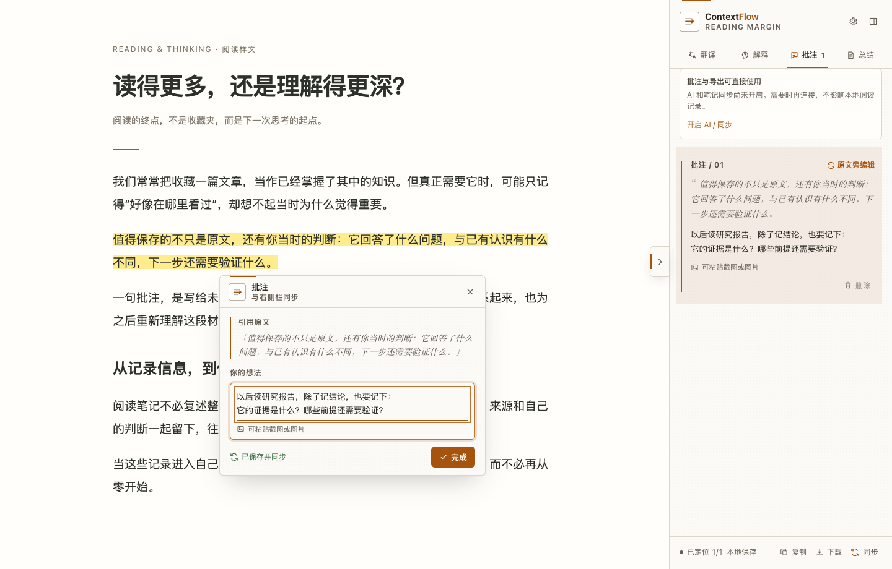

<h1>ContextFlow</h1>

<h3>把阅读，变成可复用的上下文。</h3>

在原文旁思考，用 AI 深入理解，让阅读回到自己的知识系统。

  <a href="https://github.com/PengheLiu/ContextFlow/releases/latest"><strong>下载 Chrome 扩展</strong></a>
  · <a href="./docs/GETTING_STARTED.md">开始使用</a>
  · <a href="./README.en.md">English</a>

开源 · 本地优先 · Markdown · Obsidian · 思源

> **发布状态：** Chrome 商店版 v0.3.1 正在审核，当前请[下载扩展包并手动安装](./docs/GETTING_STARTED.md#安装扩展)。商店上架后会在这里更新安装入口。

ContextFlow 是为深度阅读打造的浏览器阅读工作台。读论文、技术文章或研究报告时，把**原文、疑问和自己的判断**留在一起，再将它们整理进自己的笔记，而不是散落在收藏夹、聊天窗口和临时文档里。

原文旁直接写，侧栏同步收录。使用原创样文与示例批注，截自 v0.3.2 开发版；当前 v0.3.1 发行包已支持原位批注、侧栏同步与 Markdown 导出。

## 不只保存文章，也保留你为什么读它

### 思考，不必离开原文

选中一段话，就能在原文旁高亮、写批注、粘贴截图。无需先切到侧栏寻找输入框，也不用把一句话搬到另一个工具里才能记录想法。

原位面板与侧栏编辑的是**同一条记录**：就地捕捉想法，在侧栏集中回看；点击记录，可以定位回原文。重新打开文章时，已保存的标记会尝试恢复。

### 有疑问，就沿着上下文追问

对选中内容进行解释或翻译，在当前页面继续追问；长文可以先看速览，再回到具体段落深入理解。AI 结果和自己的补充一起留在阅读记录中，也可以在补充里粘贴图片。

你选择模型与本地 agent，ContextFlow 负责把问题带到阅读现场。AI 能力需要连接配套服务，不影响基础批注和导出的独立使用。

### 读完之后，回到自己的笔记

把速览、批注、解释、翻译和自己的总结整理为带来源的 Markdown，直接复制或下载；连接本地服务后，也能同步到 **Obsidian、Markdown 目录或思源笔记**。

同一篇文章持续更新同一份笔记，减少反复整理。浏览器内输入自动保存；写入笔记软件由你点击「同步」触发。笔记保留为你能够管理、迁移和继续编辑的内容。

## 让过去的理解，参与此刻的阅读

笔记不必只成为阅读的终点，也可以成为下一次理解的起点。

为本地 agent 授权指定笔记目录后，可以让它参考你的积累，围绕当前文章继续提问：

- **对照旧观点：** 这个结论，与我之前的理解有什么不同？
- **寻找关联：** 哪些笔记讨论过相同的问题？
- **继续研究：** 新材料是否回答了我以前留下的疑问？

这是 ContextFlow 连接网页、AI 与个人知识库的方式，而不是另建一个封闭的收藏库。实际检索与回答取决于你配置的 agent、授权范围和笔记内容，重要结论仍需核对原文。[了解产品理念 →](./docs/PRODUCT.md)

## 开始使用

**先完成一次有价值的阅读，不必先配置 AI。** 高亮、批注、粘贴图片和 Markdown 导出，只需扩展，不需要账号、API key 或本地服务。

1. **安装扩展。** 下载 [Chrome 扩展包 v0.3.1](https://github.com/PengheLiu/ContextFlow/releases/download/v0.3.1/contextflow-chrome-0.3.1.zip)，解压后在 `chrome://extensions` 开启开发者模式，点击「加载已解压的扩展程序」，选择含 `manifest.json` 的文件夹。
2. **留下想法。** 刷新一篇文章，选中一句正文，点击「批注」。可以从[阅读练习页](https://pengheliu.github.io/ContextFlow/demo.html)开始。
3. **把记录带走。** 打开右侧阅读记录，在底部点击「下载」，得到带原文、批注与来源的 Markdown。

[查看完整安装指南与常见问题 →](./docs/GETTING_STARTED.md)

支持桌面 Chrome / Chromium 111+ 的普通网页。Chrome 内部页面、扩展商店和内置 PDF 阅读器暂不支持。当前界面主要为中文。

### 按你的工作方式，开启更多能力

| 能力 | 需要准备 |
| --- | --- |
| 高亮、原位批注、图片补充、Markdown 导出 | 仅安装扩展 |
| 同步到 Obsidian / Markdown / 思源 | 本地配套服务 + 保存位置，无需配置 AI |
| AI 速览、解释、追问、翻译 | 本地服务 + 自己的模型或 agent 配置 |
| 参考个人笔记回答问题 | 本地 agent + 明确授权的笔记目录 |

配套服务需要 Node.js 22.5+；目前通过终端安装和启动。模型费用由你使用的服务决定，ContextFlow 不提供内置模型额度。[配置 AI 与笔记同步 →](./docs/GETTING_STARTED.md#开启-ai-和笔记同步)

## 数据在你的工具里，权限由你决定

- **本地优先，不设阅读云账号。** 浏览器记录保存在扩展私有存储；配套服务在本机运行，写入你选择的目录或笔记服务。
- **AI 去向取决于你的配置。** 文章、问题及授权笔记内容可能发送到所选模型或 agent 服务。本地优先不等于所有 AI 都离线运行。
- **个人笔记按范围授权。** 本地 agent 默认使用受限配置；完整权限需要显式选择。不要把配对码、API key 或私人笔记上传到公开反馈中。

请定期导出或同步备份。卸载扩展会清除浏览器内记录，不会删除已导出的文件或已同步笔记；网页结构变化也可能影响原文标记恢复。

[隐私政策](https://pengheliu.github.io/ContextFlow/privacy.html) · [数据保存与升级说明](./docs/GETTING_STARTED.md#日常运行与升级)

## 反馈与参与

遇到问题或有使用建议，欢迎[提交 Issue](https://github.com/PengheLiu/ContextFlow/issues)。请附上扩展版本、浏览器版本、复现步骤和脱敏截图。

[发行记录](https://github.com/PengheLiu/ContextFlow/releases) · [开发指南](./docs/DEVELOPMENT.md) · [架构与安全设计](./DESIGN.md) · [MIT License](./LICENSE)
