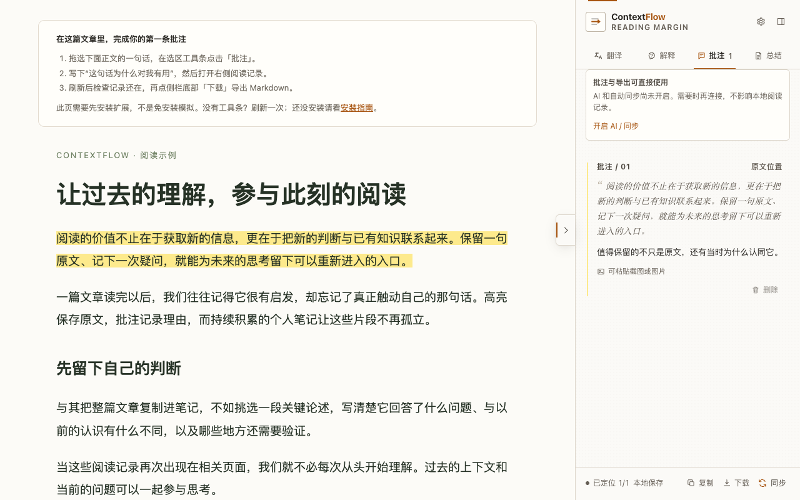

# ContextFlow

**在网页上高亮、就地批注，把阅读中的想法保存成自己的 Markdown。** 需要时，再接入 AI 和个人笔记库。

[下载试用](https://github.com/PengheLiu/ContextFlow/releases/latest) · [安装与使用指南](./docs/GETTING_STARTED.md) · [练习文章](https://pengheliu.github.io/ContextFlow/demo.html) · [English](./README.en.md)

> Chrome 商店版 v0.3.1 已提交审核，尚未正式上架。现在可以通过下方步骤加载试用；审核通过后可直接从商店安装。当前源码中的 v0.3.2 新手引导改进尚未发布为安装包。

## 你可以用它做什么？

- **边读边想：** 选中文字，直接在原文旁写批注或粘贴截图，右侧阅读记录同步更新。
- **读完带走：** 把原文、想法和来源一起导出 Markdown，放进 Obsidian 或其他笔记软件。
- **按需深入：** 连接自己的本地服务，用 AI 解释、翻译和速览；还可以让本地 agent 参考你授权的个人笔记。

v0.3.2 开发版界面预览。基础批注与导出在当前 v0.3.1 试用包中也已支持。

## 先用起来，不用配置 AI

高亮、批注、图片补充和 Markdown 导出**不需要账号、Node.js、API key 或本地服务**。首次只需完成一次「批注 → 导出」。

### 1. 安装扩展

商店审核期间，使用当前的 [v0.3.1 试用包](https://github.com/PengheLiu/ContextFlow/releases/tag/v0.3.1)：

1. 下载 Assets 中的 **contextflow-chrome-0.3.1.zip**，解压到一个固定文件夹。
2. 在 Chrome 地址栏输入 `chrome://extensions`，打开右上角「开发者模式」。
3. 点击「加载已解压的扩展程序」，选择**里面有 manifest.json 的文件夹**，不要选择 ZIP。
4. 打开普通文章网页并刷新一次。扩展的连接设置可以稍后再做。

此步骤无需下载 companion 服务包，也无需运行任何命令。最低浏览器版本为 Chromium 111；推荐使用已更新的桌面版 Chrome。

### 2. 留下第一条批注

1. 打开[练习文章](https://pengheliu.github.io/ContextFlow/demo.html)，拖选一句正文。
2. 在选区旁的工具条点「批注」，写下“这句话为什么对我有用”，或直接粘贴截图。
3. 打开页面右侧的 ContextFlow 把手，确认能看见这条记录。
4. 在侧栏底部点「下载」，得到包含原文、想法和来源的 Markdown。

刷新练习页，批注仍应恢复。已安装但没反应？先刷新文章；Chrome 内部页面、商店页和内置 PDF 阅读器不能使用。

## 哪些功能需要额外设置？

| 你想做什么 | 需要准备什么 |
| --- | --- |
| 高亮、批注、图片补充、复制或下载 Markdown | 只需安装扩展 |
| 把记录同步到 Obsidian、Markdown 目录或思源 | 本地配套服务 + 选择保存位置；不要求先配置 AI |
| AI 翻译、解释、文章速览 | 本地服务 + 自己的模型配置，费用由模型服务决定 |
| 让 AI 参考以前的个人笔记 | 上述配置 + 已安装的本地 agent + 明确授权笔记目录 |

批注输入会自动保存在浏览器；写入笔记软件时，需要点击侧栏底部的「同步」。

### 开启 AI 或笔记同步

1. 下载发行页中的 **contextflow-companion-0.3.1.zip**。这是服务包，不是要加载进 Chrome 的文件。
2. 安装 [Node.js 22.5+](https://nodejs.org/en/download)，在解压后的服务文件夹运行：

   ~~~bash
   npm ci --omit=dev
   npm run server
   ~~~

3. 在扩展自己的「扩展程序选项」页复制专属配对命令，到服务文件夹的**另一个终端**执行。
4. 把生成的配对码粘贴回扩展页并验证连接，再到文章侧栏「配置」选择笔记位置或模型。

[完整连接步骤、成功标志和故障排查 →](./docs/GETTING_STARTED.md#开启-ai-和笔记同步)

配对码不是模型 API key；它只用于本机连接。AI 使用你选择的模型或 agent，扩展不提供内置模型额度。打开阅读面板可能触发 AI 速览；相关内容可能发给你配置的服务。

## 记录在哪里？会不会丢？

扩展内的记录保存在**扩展私有存储**；本地服务把同步后的记录写入你选择的目录或笔记服务。ContextFlow 不提供集中存放阅读记录的云端账号。

请定期导出或同步。卸载扩展会清除扩展内数据，但不会删除已导出的文件、本地服务数据库或已同步笔记。旧开发版的网页缓存不会自动导入新版，升级前先导出或同步。

[隐私政策](https://pengheliu.github.io/ContextFlow/privacy.html) · [当前限制与常见问题](./docs/GETTING_STARTED.md#遇到问题)

## 让过去的理解，参与此刻的阅读

当你已经保存了一些想法，可以进一步让本地 agent 对照个人笔记：这个概念以前怎样理解？新证据支持还是修正了旧判断？哪些未完成的问题又值得回看？

这是 ContextFlow 的长期方向。先从一条能带走的批注开始，再让个人上下文逐渐回到阅读现场。[了解产品思路 →](./docs/PRODUCT.md)

## 开发与贡献

普通用户无需克隆代码或自行编译。开发者请看[开发与发布指南](./docs/DEVELOPMENT.md)；架构、锚点恢复与权限边界见 [DESIGN.md](./DESIGN.md)。

[报告问题](https://github.com/PengheLiu/ContextFlow/issues)时，请提供浏览器版本、扩展版本、操作步骤和经过脱敏的截图。不要提交配对码、API key 或私人笔记。

MIT License · Local-first · Obsidian / Markdown / 思源
