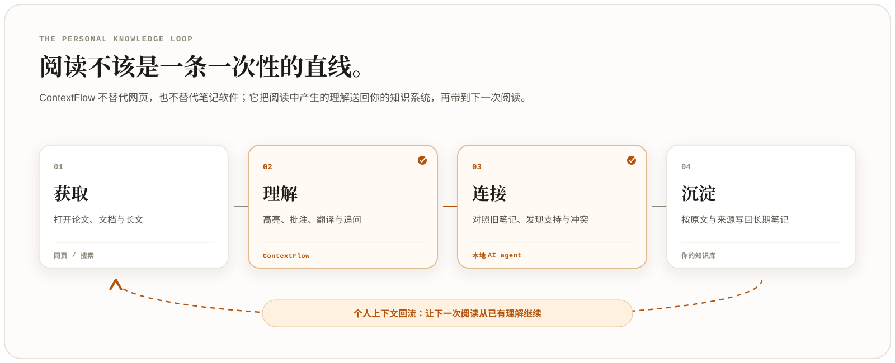

# 让过去的理解参与此刻的阅读

[返回首页](../README.md)

网页知道你正在读什么，个人笔记保留你以前想过什么。ContextFlow 希望把这两端连起来：在原文旁留下判断，让新的证据回到自己的笔记，也让旧的理解参与新阅读。

## 从留下想法，到带回上下文

第一步是能用、能保存：选中原文，写下批注，导出带来源的 Markdown。记录应该能被其他编辑器和笔记软件继续使用。

第二步是减少整理：将同一篇文章的速览、批注、解释和自己的总结持续写回一份文档，而不是每次同步又生成一篇孤立记录。

第三步才是个人上下文：授权本地 agent 读取自己的笔记，围绕明确的问题检索、对照和引用。AI 的回答应有可核对的来源；读过这次答案之后，记录仍应回到自己可管理的工具里。

## 四种值得支持的阅读问题

- **比较定义：** 这篇文章的概念与我以前的定义相同吗？前提有什么变化？
- **寻找冲突：** 新证据是否修正旧判断？两项结果是否使用了不同任务和指标？
- **回看演化：** 我为什么从疑问变成了现在的判断，中间缺少什么证据？
- **召回未解问题：** 今天的材料是否回答了曾经没想通的问题？

这些是建立在笔记质量、agent 能力与授权范围上的使用方向，不应包装成安装后自动完成的保证。首次安装不需要用户先理解这些概念。

## 数据与权限

扩展在自己的私有存储里保存浏览器侧记录。笔记同步由用户自己的本地服务执行；模型或 agent 服务是否把内容发往外部，取决于用户配置。

默认从受限 agent 配置开始。完整权限可能涉及命令、文件写入、网络或 MCP，应在确有需要时单独理解并授权。可移植的阅读记录与明确的数据边界，是长期使用的前提。

[从第一条批注开始](./GETTING_STARTED.md) · [完整能力与兼容边界](./CAPABILITIES.md)
